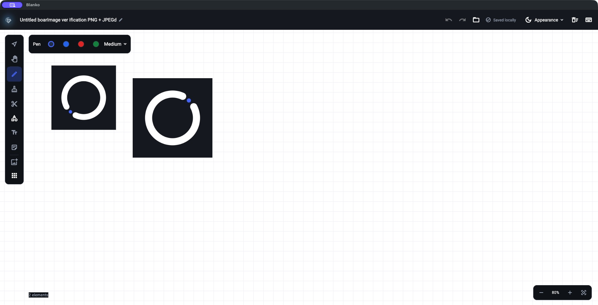
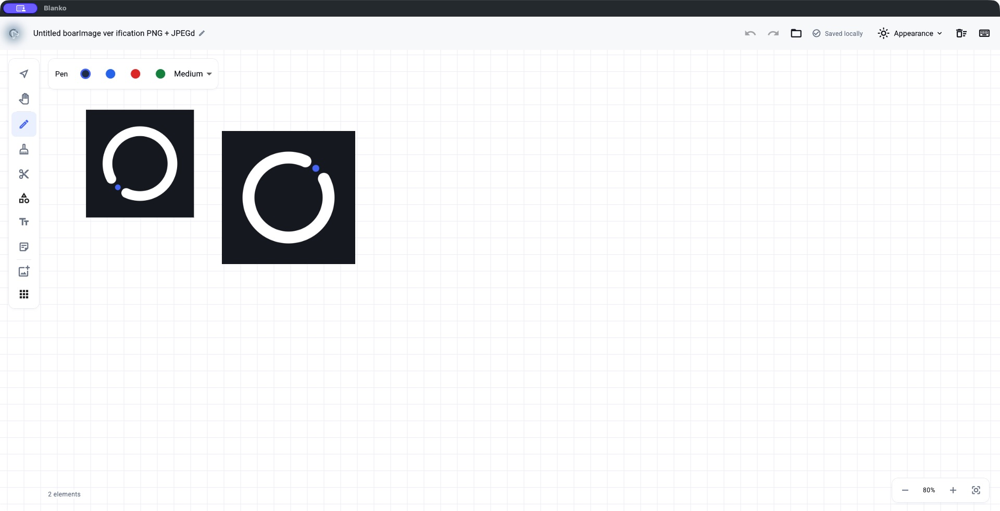
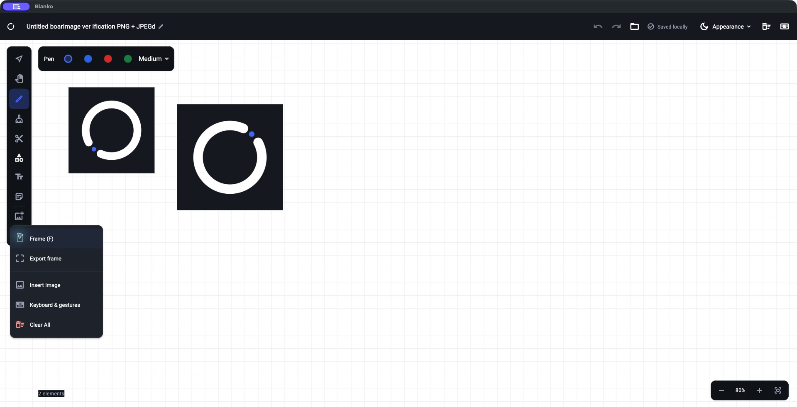
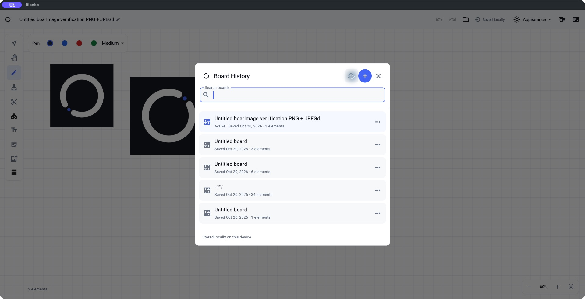
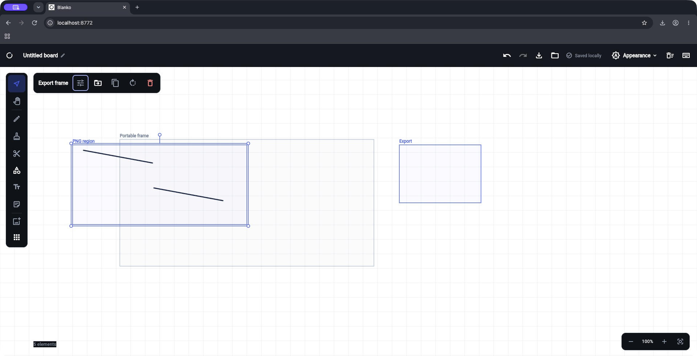
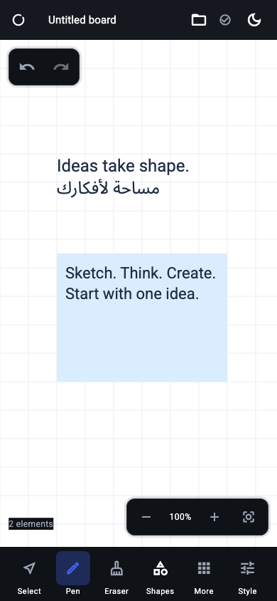

<div align="center">


# Blanko

### سبورة رقمية مفتوحة المصدر — ارسم أفكارك بحرية

سبورة لانهائية مبنية بـ Flutter، تعمل بدون إنترنت، بياناتك عندك.

[](https://flutter.dev)
[](LICENSE)
[]()
[]()

[**⬇️ تحميل**](#-التحميل) · [**✨ المميزات**](#-المميزات) · [**🔧 البناء من المصدر**](#-البناء-من-المصدر) · [**🤝 المساهمة**](#-المساهمة)

</div>

---

## 🎨 ما هو Blanko؟

**Blanko** سبورة رقمية مجانية ومفتوحة المصدر تتيح لك رسم أفكارك وتنظيم محتواك البصري بحرية كاملة. التطبيق يعمل بالكامل على جهازك بدون حسابات أو اشتراكات — ملفاتك ومشاريعك تبقى ملكك.

يمكنك استخدامه لشرح فكرة، تخطيط مشروع، تدوين ملاحظات بصرية، أو تصدير رسوماتك كصور عالية الجودة.

---

## ✨ المميزات

<table>
<tr>
<td width="50%">

### 🖊️ أدوات الرسم
- لوحة لانهائية مع تكبير وتحريك سلس
- أقلام رسم مع تنعيم ذكي للخطوط
- هايلايتر بشفافية طبيعية
- ممحاة كائنات وممحاة مقاطع
- مستطيل، دائرة، مثلث، خط وأسهم
- ألوان وسماكات متعددة

</td>
<td width="50%">

### 📝 النصوص والملاحظات
- نصوص عربية وإنجليزية مع اتجاه تلقائي
- ملاحظات لاصقة بألوان متعددة
- تحرير متعدد الأسطر مع دعم IME
- خطوط Roboto و Noto Sans Arabic مُضمّنة

</td>
</tr>
<tr>
<td width="50%">

### 🖼️ الصور والإطارات
- استيراد صور PNG و JPEG
- إطارات لتنظيم المحتوى
- تجميع وفك تجميع العناصر
- تحريك، تدوير، تغيير حجم وقفل
- نسخ ولصق بين اللوحات

</td>
<td width="50%">

### 💾 الحفظ والتصدير
- حفظ تلقائي محلي — لا حاجة للحفظ اليدوي
- تصدير PNG بدقات مخصصة حتى 4K
- ملفات `.wboard` قابلة للنقل بين الأجهزة
- مكتبة لوحات مع إنشاء وتكرار وحذف
- تراجع/إعادة غير محدود في الجلسة
- وضع داكن 🌙 فاتح ☀️ وتلقائي

</td>
</tr>
</table>

---

## 📸 لقطات من التطبيق

<table>
<tr>
<td align="center">
<br>
<sub>المحرر — الوضع الداكن</sub>
</td>
<td align="center">
<br>
<sub>المحرر — الوضع الفاتح</sub>
</td>
</tr>
<tr>
<td align="center">
<br>
<sub>أدوات الرسم والأشكال</sub>
</td>
<td align="center">
<br>
<sub>مكتبة اللوحات</sub>
</td>
</tr>
<tr>
<td align="center">
<br>
<sub>الإطارات والتصدير</sub>
</td>
<td align="center">
<br>
<sub>واجهة الهاتف</sub>
</td>
</tr>
</table>

---

## ⬇️ التحميل

> [!NOTE]
> هذه **نسخة تجريبية عامة** (Public Beta). التطبيق يعمل بشكل جيد لكن قد تصادف بعض المشاكل البسيطة.

| المنصة | التحميل | ملاحظات |
|--------|---------|---------|
| 🪟 **Windows** | [Blanko-Windows-x64.zip](https://github.com/Ahmedelsapagh10/whitebaord/releases/latest) | فك الضغط وشغّل `whiteboard.exe` |
| 🐧 **Linux** | [Blanko-Linux-x64.tar.gz](https://github.com/Ahmedelsapagh10/whitebaord/releases/latest) | فك الضغط وشغّل `bundle/whiteboard` |
| 🍎 **macOS** | [Blanko-macOS.zip](https://github.com/Ahmedelsapagh10/whitebaord/releases/latest) | فك الضغط واسحب إلى Applications |
| 📱 **Android** | [Blanko-Android.apk](https://github.com/Ahmedelsapagh10/whitebaord/releases/latest) | فعّل التثبيت من مصادر خارجية |
| 🌐 **Web** | بناء من المصدر | `flutter run -d chrome` |

> [!IMPORTANT]
> - تطبيق macOS **غير موثّق من Apple** — قد تحتاج للسماح بفتحه من إعدادات النظام
> - APK الأندرويد موقّع بمفتاح Debug — للتجربة والاستخدام الشخصي
> - تحقق من سلامة الملفات عبر `SHA256SUMS.txt` في صفحة الإصدار

---

## 💡 لماذا Blanko؟

| | |
|---|---|
| 🔒 **خصوصية كاملة** | لا حسابات، لا تسجيل دخول، لا تتبع |
| 📴 **يعمل بدون إنترنت** | بعد التثبيت لا حاجة لاتصال |
| 💻 **متعدد المنصات** | كود واحد لـ macOS, Windows, Linux, Android, Web |
| 📁 **ملفاتك ملكك** | بيانات محلية وملفات `.wboard` قابلة للنقل |
| 🛠️ **مفتوح المصدر** | كود شفاف تحت رخصة MIT |
| 🎯 **مبني بـ Flutter** | أداء عالي وتجربة مستخدم سلسة |

---

## 🔧 البناء من المصدر

### المتطلبات

- [Flutter SDK](https://flutter.dev/docs/get-started/install) 3.41.x (stable)
- Dart SDK 3.11.x (يأتي مع Flutter)
- **macOS**: Xcode 26+
- **Windows**: Visual Studio 2022+ مع "Desktop development with C++"
- **Linux**: `sudo apt-get install ninja-build libgtk-3-dev`
- **Android**: Android SDK مع Java 17

### التشغيل

```bash
git clone https://github.com/Ahmedelsapagh10/whitebaord.git
cd whitebaord
flutter pub get

# macOS
flutter run -d macos

# Windows
flutter run -d windows

# Linux
flutter run -d linux

# Chrome
flutter run -d web-server --web-port=8766 --web-hostname=localhost

# Android
flutter run -d <device-id>
```

### بناء نسخة الإصدار

```bash
flutter build macos --release
flutter build windows --release
flutter build linux --release
flutter build apk --release
```

---

## 🤝 المساهمة

نرحب بمساهمات مطوري Flutter! 🎉

1. اعمل Fork للمستودع
2. أنشئ فرع جديد لميزتك
3. تأكد من نجاح `flutter analyze` و `flutter test`
4. افتح Pull Request

📖 راجع [دليل المساهمة](CONTRIBUTING.md) للتفاصيل

🐛 [الإبلاغ عن مشكلة](https://github.com/Ahmedelsapagh10/whitebaord/issues/new?template=bug_report.md)
✨ [اقتراح ميزة](https://github.com/Ahmedelsapagh10/whitebaord/issues/new?template=feature_request.md)

---

## ⚠️ حدود النسخة التجريبية

> [!WARNING]
> هذه نسخة تجريبية عامة (Public Beta) وليست إصدار مستقر.

- لم يُختبر بشكل كامل على أجهزة لوحية أو أقلام رقمية
- تطبيق macOS غير موقّع من Apple (يتطلب سماح يدوي)
- APK Android يستخدم توقيع Debug
- أداء المشاريع الكبيرة جداً لم يُحسّن بعد
- لا يوجد مزامنة سحابية أو تعاون مباشر حالياً

---

## 📄 الترخيص

[MIT License](LICENSE) — استخدم، عدّل، وزّع بحرية.

الخطوط المُضمّنة (Roboto, Noto Sans Arabic) مرخصة تحت [SIL Open Font License](assets/benchmark_fonts/Roboto-OFL.txt).

---

<div align="center">

**صنع بـ ❤️ باستخدام Flutter**

[⬆ العودة للأعلى](#blanko)

</div>
